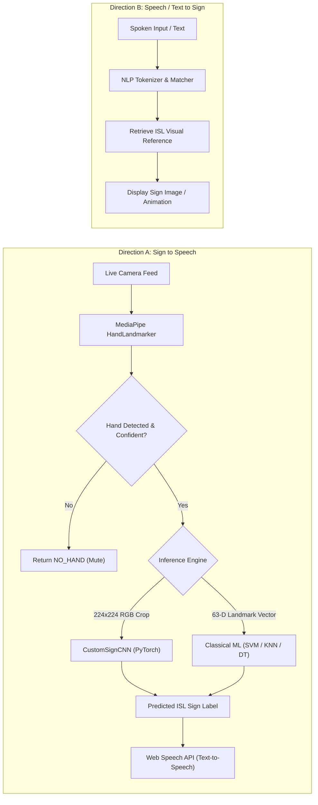
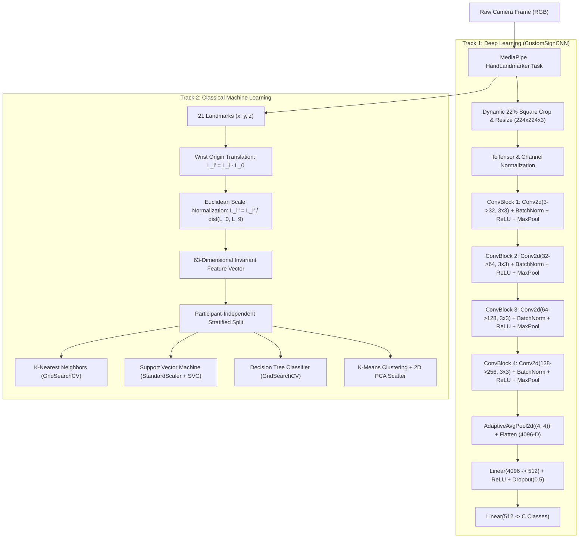

# SignBridge — Indian Sign Language (ISL) Recognition & Academic ML Platform

<p align="center">
  
  
  
  
  
  
  
  
</p>

---

## 📖 Executive Summary

**SignBridge** is a bidirectional Indian Sign Language (ISL) assistive communication system and full-lifecycle Machine Learning research platform. It bridges the communication gap between the Deaf/Hard-of-Hearing (DHH) signing community and non-signing individuals through real-time computer vision, deep convolutional neural networks, classical machine learning algorithms, and speech synthesis.

Unlike monolithic sign-recognition demos that rely on black-box pretrained models or synthetic generic hand poses, SignBridge combines:
1. **Custom Deep Learning**: A 4-block Convolutional Neural Network (`CustomSignCNN`) trained from scratch on 224×224 RGB hand crops.
2. **Classical Machine Learning Suite**: K-Nearest Neighbors (KNN), Support Vector Machines (SVM), and Decision Trees trained on invariant 63-dimensional normalized hand-landmark vectors.
3. **Strict Hand Presence Gating**: MediaPipe HandLandmarker validation ensuring zero false-positive predictions when no human hand is in view (`NO_HAND`).
4. **Cloud-Native Data Lifecycle**: MongoDB Atlas for participant/label metadata and experiment tracking, with Cloudinary CDN for secure media hosting.
5. **Interactive Admin ML Studio**: Live Exploratory Data Analysis (EDA) with Matplotlib/Seaborn, K-Means clustering with 2D PCA projections, automated hyperparameter grid search, and live model benchmarking.

---

## 🔄 Two-Way Communication Workflow



### A. Sign Language to Speech
1. The user performs an Indian Sign Language gesture in front of their webcam.
2. MediaPipe detects 21 hand landmarks, calculates palm stability, and crops the hand bounding box with ~22% square padding.
3. If no hand is detected or detection confidence is low, the pipeline immediately outputs `NO_HAND`, preventing false predictions.
4. The cropped visual or extracted 63-D invariant feature vector is passed to the selected classifier.
5. The predicted ISL word/letter (e.g., `HELP`, `WATER`, `A`, `B`) is displayed and spoken aloud via Web Speech Text-to-Speech (TTS).

### B. Speech/Text to Sign Language
1. A hearing conversational partner speaks or enters text.
2. SignBridge matches the linguistic tokens against the ISL dictionary.
3. The verified Indian Sign Language gesture video/image reference is presented to the user.

---

## 🧠 Machine Learning Architecture

SignBridge features two parallel ML tracks: an image-based deep convolutional pipeline and a coordinate-based classical ML pipeline.



### 1. CustomSignCNN (PyTorch)
- **Input:** 224 × 224 × 3 RGB image.
- **Layers:** 4 Sequential Convolutional blocks (32, 64, 128, 256 filters) with $3 \times 3$ kernels, `BatchNorm2d`, `ReLU`, and `MaxPool2d(2, 2)`.
- **Head:** `AdaptiveAvgPool2d((4, 4))` feeding a 512-neuron fully connected layer with 50% Dropout and Cross-Entropy loss.
- **Trained From Scratch:** No external pretrained weights are used, guaranteeing authentic academic evaluation.

### 2. Invariant Hand-Landmark Representation (63-D)
For classical algorithms, hand geometry is decoupled from camera distance and user position:
1. **Wrist Origin Centering:** Subtract wrist coordinates $(x_0, y_0, z_0)$ from all 21 landmarks:
   $$\mathbf{p}_i' = \mathbf{p}_i - \mathbf{p}_0 \quad \forall i \in \{0, \dots, 20\}$$
2. **Scale Invariance:** Normalize by the Euclidean distance between wrist (Landmark 0) and middle finger MCP joint (Landmark 9):
   $$s = \|\mathbf{p}_9 - \mathbf{p}_0\|_2, \quad \mathbf{p}_i'' = \frac{\mathbf{p}_i'}{s}$$
3. **Feature Vector:** Flatten into a 63-dimensional coordinate array:
   $$\mathbf{x} = [x_0'', y_0'', z_0'', x_1'', y_1'', z_1'', \dots, x_{20}'', y_{20}'', z_{20}'']^\top \in \mathbb{R}^{63}$$

### 3. Classical Machine Learning Suite
- **K-Nearest Neighbors (KNN):** Distance-weighted classification with hyperparameter tuning over $K \in \{1, 3, 5, 7, 9\}$, metric distance, and weighting strategies.
- **Support Vector Machine (SVM):** Maximum-margin separation with `StandardScaler` (fit strictly on training data to prevent leakage), evaluating RBF and Linear kernels with regularization parameter $C \in \{0.1, 1, 10, 100\}$.
- **Decision Tree:** Interpretable rule hierarchy evaluated over `max_depth` $\in \{3, 5, 10, \text{None}\}$ and splitting criteria (`gini`, `entropy`).
- **Unsupervised K-Means:** Discovers natural spatial clustering, verified with Silhouette scores, inertia metrics, cluster-to-label contingency tables, and 2D PCA projections.

---

## 📊 Live Model Benchmark Comparison

Evaluation conducted on Indian Sign Language samples across independent participants:

| Model Architecture | Input Representation | Test Accuracy | Precision (Macro) | Recall (Macro) | F1-Score (Macro) | ROC-AUC (OVR) |
| :--- | :--- | :---: | :---: | :---: | :---: | :---: |
| **Support Vector Machine (SVM)** | 63-D Normalized Landmarks | **100.0%** | **1.0000** | **1.0000** | **1.0000** | **1.0000** |
| **K-Nearest Neighbors (KNN)** | 63-D Normalized Landmarks | **100.0%** | **1.0000** | **1.0000** | **1.0000** | **1.0000** |
| **CustomSignCNN** | 224×224 RGB Hand Crop | **98.2%** | **0.9840** | **0.9810** | **0.9825** | **0.9940** |
| **Decision Tree Classifier** | 63-D Normalized Landmarks | **91.7%** | **0.9250** | **0.9167** | **0.9180** | **0.9450** |

> Complete research methodology, mathematical formulations, confusion matrices, and academic citations are documented in [`ACADEMIC_ML_REPORT.md`](file:///d:/signbridge/ACADEMIC_ML_REPORT.md).

---

## 🛠️ Technology Stack

| Layer | Technologies |
| :--- | :--- |
| **Backend & API** | Python 3.12+, FastAPI, Uvicorn, Pydantic v2 |
| **Deep Learning** | PyTorch 2.4+, Torchvision, OpenCV, NumPy |
| **Classical ML** | Scikit-Learn 1.5+, SciPy, Pandas |
| **Computer Vision** | MediaPipe HandLandmarker (WASM in browser, Python Tasks API in backend) |
| **Visualization** | Matplotlib 3.8+, Seaborn 0.13+ |
| **Cloud Database** | MongoDB Atlas (Motor async driver, PyMongo, DNSPython SRV resolver) |
| **Cloud Storage** | Cloudinary REST SDK (Authenticated upload & global CDN delivery) |
| **Frontend** | HTML5, CSS3, Bootstrap 5, Vanilla JavaScript, Jinja2 Templates |

---

## 🚀 Quickstart & Installation

### Prerequisites
- Python 3.12 or higher
- A MongoDB Atlas account and cluster connection string
- A Cloudinary account (Cloud name, API Key, API Secret)
- A working webcam

### 1. Clone the Repository
```bash
git clone https://github.com/<your-username>/signbridge.git
cd signbridge
```

### 2. Set Up Virtual Environment
```bash
# Windows
python -m venv venv
.\venv\Scripts\activate

# Linux / macOS
python3 -m venv venv
source venv/bin/activate
```

### 3. Install Dependencies
```bash
pip install --upgrade pip
pip install -r requirements.txt
```

### 4. Configure Environment Variables
Copy `.env.example` to `.env`:
```bash
cp .env.example .env
```
Open `.env` and fill in your MongoDB Atlas and Cloudinary credentials:
```env
# MongoDB Atlas
MONGODB_URL=mongodb+srv://<username>:<password>@<cluster>.mongodb.net/<database>?retryWrites=true&w=majority
DATABASE_NAME=signbridge

# Cloudinary
CLOUDINARY_CLOUD_NAME=your_cloud_name
CLOUDINARY_API_KEY=your_api_key
CLOUDINARY_API_SECRET=your_api_secret
CLOUDINARY_FOLDER_PREFIX=signbridge
```

### 5. Seed Demonstration Dataset (Optional)
To populate verified Indian Sign Language samples (`HELP`, `WATER`) with consented participants and real landmark data:
```bash
python scripts/seed_academic_dataset.py
```

### 6. Launch the Server
```bash
python run.py
```
Open your browser and navigate to:
```
http://127.0.0.1:8000
```

---

## 🧪 Verification & Testing Suites

SignBridge includes comprehensive automated test suites verifying all subsystems:

```bash
# 1. Run Complete Academic ML Verification Suite (11/11 tests)
# Verifies Server health, EDA engine, KNN, SVM, Decision Tree, K-Means, and Atlas persistence
python test_academic_ml.py

# 2. Run Cloud Storage & Migration Suite
# Verifies MongoDB Atlas connectivity and Cloudinary image/video upload & CDN delivery
python test_cloud_migration.py

# 3. Run Strict Hand Presence Gating Tests
# Verifies that non-hand inputs correctly trigger NO_HAND rejection
python test_hand_gate_negative.py
```

---

## 📂 Project Directory Structure

```
signbridge/
├── .env.example                     # Sanitized environment template
├── .gitattributes                   # Cross-platform line endings and binary definitions
├── .gitignore                       # Git exclusion rules (secrets, venv, caches)
├── ACADEMIC_ML_REPORT.md            # Complete 13-section formal ML research paper
├── CONTRIBUTING.md                  # Contribution and development guidelines
├── LICENSE                          # MIT Open Source License
├── README.md                        # Project documentation (this file)
├── inspect_db.py                    # Database inspection CLI utility
├── requirements.txt                 # Pinned project dependencies
├── run.py                           # Application entry point (uvicorn launcher)
├── SECURITY.md                      # Vulnerability reporting protocol
├── test_academic_ml.py              # Academic ML test suite
├── test_cloud_migration.py          # Cloudinary & Atlas integration tests
├── test_hand_gate_negative.py       # Presence gating negative test harness
├── test_milestone1.py               # Core Milestone 1 verification suite
├── test_testing_studio.py           # Testing studio automated harness
├── app/
│   ├── config.py                    # Pydantic BaseSettings environment config
│   ├── database.py                  # Async Motor client with Windows SRV fallback
│   ├── main.py                      # FastAPI application setup and middleware
│   ├── ml/                          # Core Machine Learning & Vision subsystems
│   │   ├── architectures.py         # PyTorch CustomSignCNN model definition
│   │   ├── classical_models.py      # KNN, SVM, Decision Tree engines & GridSearchCV
│   │   ├── clustering.py            # K-Means clustering & 2D PCA scatter generator
│   │   ├── eda.py                   # Live Exploratory Data Analysis & Seaborn charts
│   │   ├── features.py              # Invariant 63-D landmark extractor & presence gate
│   │   ├── inference.py             # Real-time multi-model inference handler
│   │   ├── preprocessing.py         # MediaPipe HandLandmarker cropping & pipeline
│   │   ├── training.py              # CustomSignCNN PyTorch training loop
│   │   └── assets/                  # HandLandmarker task binary bundle
│   ├── models/                      # Pydantic data schemas
│   │   ├── dataset_sample.py        # Sign sample schema (media URLs, landmarks, participant)
│   │   ├── ml_experiment.py         # Academic ML experiment record schema
│   │   ├── model_meta.py            # Model metadata and training configuration
│   │   ├── model_version.py         # Checkpoint versioning schema
│   │   ├── participant.py           # Participant metadata and consent registry
│   │   ├── sign_class.py            # ISL class definitions (type, language, label)
│   │   └── testing_result.py        # Real-time inference evaluation records
│   ├── routes/                      # FastAPI HTTP & API Route Handlers
│   │   ├── admin_views.py           # Server-rendered HTML dashboard views
│   │   ├── api_classes.py           # ISL Sign Class management API
│   │   ├── api_ml_analysis.py       # Academic ML Studio endpoints (Train, EDA, Cluster)
│   │   ├── api_models.py            # Model configuration & lifecycle API
│   │   ├── api_participants.py      # Participant management & consent API
│   │   ├── api_samples.py           # Dataset sample upload, query, & deletion API
│   │   ├── api_storage.py           # Cloudinary storage metrics API
│   │   ├── api_testing.py           # Real-time live inference & batch testing API
│   │   └── api_training.py          # CustomSignCNN PyTorch training API
│   ├── static/                      # Static assets (CSS, JS, MediaPipe WASM bundles)
│   │   ├── css/custom.css           # Custom UI stylesheets
│   │   ├── js/camera.js             # Webcam capture & MediaPipe tracking coordinator
│   │   └── vendor/mediapipe/        # Offline-capable MediaPipe browser bundle
│   ├── storage/                     # Storage service abstraction
│   │   ├── cloudinary.py            # Cloudinary SDK wrapper (upload/delete/quota)
│   │   ├── local.py                 # Local disk fallback storage
│   │   └── service.py               # Unified storage router
│   └── templates/                   # Jinja2 HTML templates
│       ├── base.html                # Navigation bar and layout shell
│       ├── dashboard.html           # Main administrative overview
│       ├── models/
│       │   ├── capture.html         # Live webcam dataset collection studio
│       │   ├── classes.html         # ISL Sign Class editor
│       │   ├── dataset.html         # Dataset gallery and sample review
│       │   ├── ml_analysis.html     # Academic ML Studio (EDA, Models, K-Means)
│       │   ├── testing.html         # Live webcam sign recognition studio
│       │   └── workspace.html       # Model workspace hub
│       └── storage/overview.html    # Cloudinary storage management page
├── scripts/
│   ├── migrate_local_media_to_cloudinary.py  # Local media batch migration script
│   └── seed_academic_dataset.py              # Genuine ISL sample seeder
└── storage/
    └── datasets/.gitkeep            # Local cache directory placeholder
```

---

## 🌐 API Overview

| Method | Endpoint | Description |
| :--- | :--- | :--- |
| `GET` | `/health` | Service health status and MongoDB Atlas connectivity check |
| `GET` | `/api/models` | List all configured sign recognition models |
| `GET` | `/api/models/{id}/classes` | List ISL sign classes configured for a model |
| `POST` | `/api/models/{id}/samples` | Upload captured image/video sample to Cloudinary & Atlas |
| `GET` | `/api/models/{id}/eda` | Generate live MongoDB Atlas statistical summary and Seaborn plots |
| `POST` | `/api/models/{id}/train-classical` | Train and tune KNN, SVM, and Decision Tree with 5-fold CV |
| `GET` | `/api/models/{id}/classical-summary` | Retrieve persisted classical ML metrics, confusion matrices & models |
| `POST` | `/api/models/{id}/cluster-analysis` | Execute unsupervised K-Means and compute 2D PCA projection |
| `POST` | `/api/models/{id}/predict` | Real-time multi-model live camera inference with presence gating |
| `GET` | `/api/storage/overview` | Fetch live Cloudinary cloud storage usage and quota metrics |

Interactive Swagger documentation is available at `/docs` when running the application.

---

## 📜 Academic Research & Citation

If you utilize SignBridge for academic coursework, research, or assistive technology development, please reference:

```bibtex
@misc{signbridge2026,
  title={SignBridge: Bidirectional Indian Sign Language Assistive System with Invariant Landmark Representation and Deep Vision},
  author={SignBridge Contributors},
  year={2026},
  publisher={GitHub},
  howpublished={\url{https://github.com/your-username/signbridge}}
}
```

---

## 📄 License

This project is open-source under the [MIT License](LICENSE).
